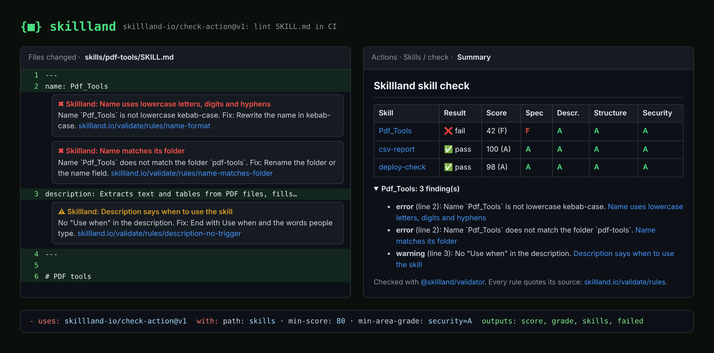

# Skillland skill check

[](https://github.com/marketplace/actions/skillland-skill-check)
[](https://github.com/skillland-io/check-action/releases)
[](https://github.com/skillland-io/check-action/actions/workflows/test.yml)
[](https://www.npmjs.com/package/@skillland/validator)
[](LICENSE)

Website: **[skillland.io](https://skillland.io)**. Check a skill in the browser, read every rule with its source, and browse scored public skills.



A GitHub Action that lints agent skills (`SKILL.md` folders) for Claude Code, Codex and Cursor on every push and pull request. It runs the open [`@skillland/validator`](https://github.com/skillland-io/skill-validator), the same rules that score the public skills on [skillland.io](https://skillland.io).

Every rule quotes the official guidance it relies on: the [Agent Skills specification](https://agentskills.io/specification), Anthropic's, OpenAI's and Cursor's docs, and the OWASP Agentic Skills Top 10. Read each rule and its source at [skillland.io/validate/rules](https://skillland.io/validate/rules).

## What you get

- **An annotation on each finding's line** of `SKILL.md` in the pull request, with a link to the rule page that explains the fix.
- **A job summary** with each skill's score (0-100), grade, and a grade for each of the four areas: Specification, Description, Structure and content, and Security. In a public repo, each skill links to its full report on skillland.io.
- **A failing check** when a skill has an error, or misses a score or area limit you set.

## Usage

```yaml
name: Skills

on:
  pull_request:
  push:
    branches: [main]

permissions:
  contents: read

jobs:
  check:
    runs-on: ubuntu-latest
    steps:
      - uses: actions/checkout@v5
      - uses: skillland-io/check-action@v1
        with:
          path: skills
          min-score: 80
          min-area-grade: security=A
```

## Inputs

| Input | Default | What it does |
| --- | --- | --- |
| `path` | `.` | A skill folder, a `SKILL.md` file, or a folder that holds many skills. Every `SKILL.md` below it is checked. |
| `min-score` | none | Fail when any skill scores below this number. With no value, the check fails only on errors. |
| `min-area-grade` | none | Fail when an area grades below a limit: `B` for every area, or `security=A` for one area (`spec`, `description`, `structure`, `security`). Separate several with spaces. |
| `validator-version` | `0.8.0` | The `@skillland/validator` version to run. |

## Outputs

| Output | What it holds |
| --- | --- |
| `score` | Score of the lowest-scoring skill |
| `grade` | Grade of the lowest-scoring skill |
| `skills` | Number of skills checked |
| `failed` | Number of skills that failed |

## Scoring

A skill starts at 100. Each failing rule costs 25 points for an error, 8 for a warning and 2 for a suggestion. Grades: A from 90, B from 80, C from 70, D from 60, F below. The full method is in the [validator README](https://github.com/skillland-io/skill-validator#scoring).

Skillland scores structure, not whether a skill does its job well.

## Other ways to run the same checks

- In the browser: [skillland.io/validate](https://skillland.io/validate)
- From a terminal: `npx -p @skillland/validator skillland check ./my-skill`
- From your agent: the [skillland-io/skills](https://github.com/skillland-io/skills) agent skills

The action needs Node 20 or later on the runner. GitHub-hosted runners already have it.

## License

MIT
